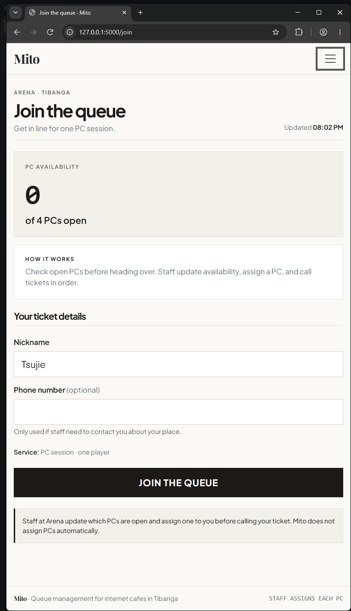
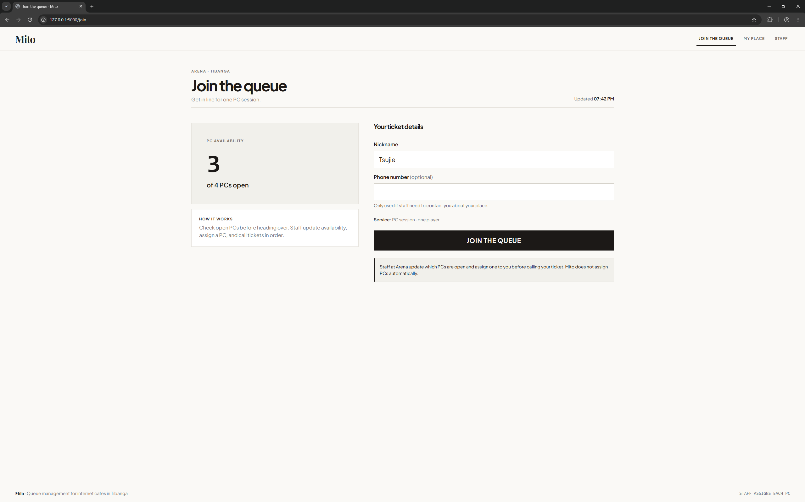
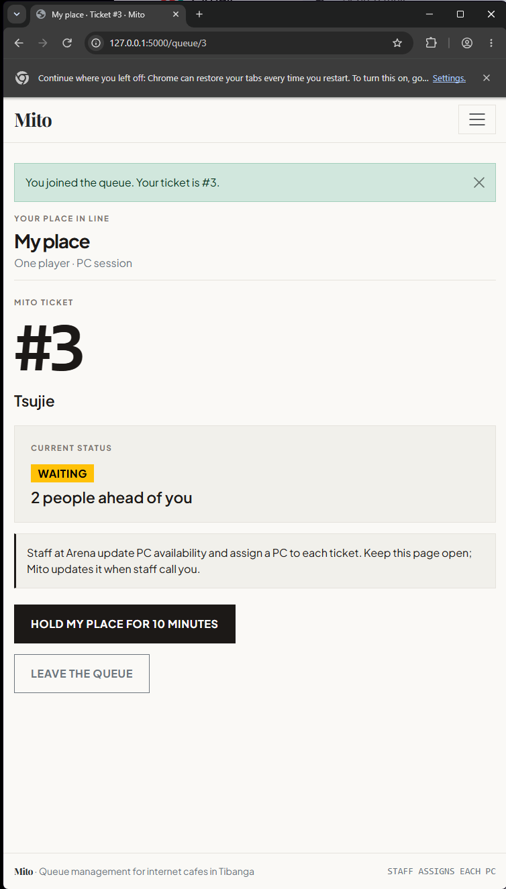
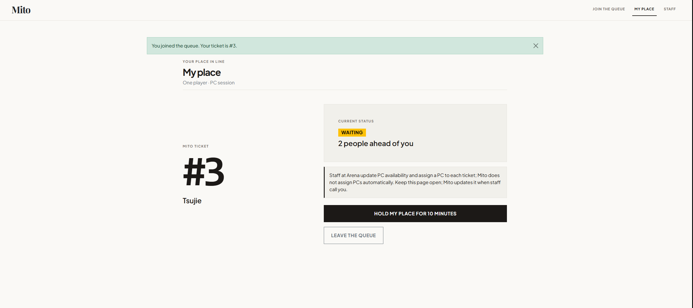
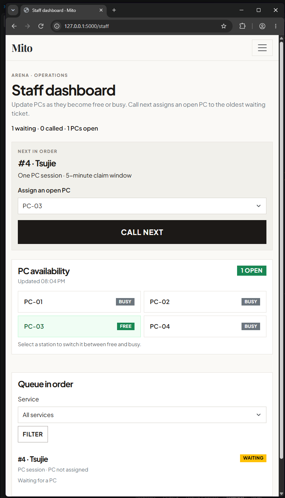
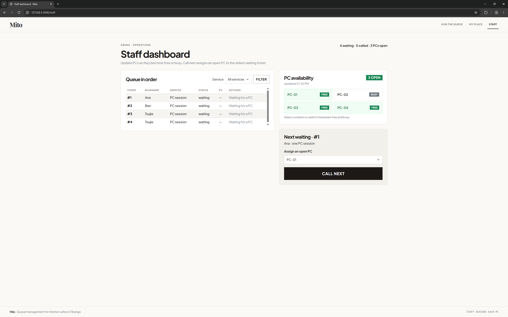

# Mito — Week 3 Interface Report

## Title details

- **App:** Mito
- **Setting:** Arena internet cafe, Tibanga
- **Name:** Calvyn Kent L. Adeva
- **Student ID:** 20240064
- **Section:** CS3B
- **Date:** October 25, 2026
- **Pull request:** Not opened yet; this branch has not been pushed. Add the PR link after the GitHub submission steps.

## Personas

- **Tsujie, person waiting:** “The internet cafe that I go to, Arena, has times where its full so I either wait or mu uli, but more often than not kay mu uli nalang ko if feel nako dugay pa ma libre ang mga PC.” *(English translation: “Arena, the internet cafe I go to, is sometimes full. I either wait or go home; more often, I just go home if I think it will take a while before any PCs become free.”)* Her main tasks are to check open PCs, join for one PC with a nickname, and follow her ticket. See [the full persona](personas.md).
- **Ethan, staff member:** “Yung current system ngayon, people roam around to look for free PCs or ask me dito sa counter kung may bakante. Pero usually, sila na mismo nag-iikot para mag-check kung may PC, tapos naghihintay kung wala pang available.” *(English translation: “The current system has customers walking around to look for free PCs or asking me at the counter whether a PC is available. Usually, they check for themselves and wait if none are free.”)* His main tasks are to update station availability, call the oldest waiting ticket, and mark it served or no-show. See [the full persona](personas.md).

## Screens

The screenshots show the running app at phone and laptop widths. The phone captures were checked at 375 px by the user.

| Screenshot | Image | Persona and requirements |
| --- | --- | --- |
| Join — phone |  | Tsujie uses the phone screen to check open PCs and join the individual queue (FR-01, FR-03). |
| Join — laptop |  | Tsujie uses the laptop screen to check open PCs and join the individual queue (FR-01, FR-03). |
| My place — phone |  | Tsujie uses the phone screen to check her ticket status and place in line (FR-02). |
| My place — laptop |  | Tsujie uses the laptop screen to check her ticket status and place in line (FR-02). |
| Staff dashboard — phone |  | Ethan uses the phone screen to view the queue in order, call and update tickets, and manually update PC availability so the open-PC count stays accurate (FR-04, FR-05). |
| Staff dashboard — laptop |  | Ethan uses the laptop screen to view the queue in order, call and update tickets, and manually update PC availability so the open-PC count stays accurate (FR-04, FR-05). |

The [earlier Staff phone screenshot](screenshots/staff-mobile-before.png) is retained as evidence of the navigation problem that led to the card layout.

## Design decisions

1. The Join screen puts the open PC count and its update time before the form because Tsujie wants to know whether travelling to Arena is worthwhile.
2. Each ticket represents one player and one PC. A nickname is required and a phone number is optional, keeping the flow simple for individual customers.
3. Staff call the oldest waiting ticket from one prominent Call next panel and assign a specific free PC there. This follows the self-review change to avoid duplicate call actions and accidental out-of-order calls.
4. My place lets a customer hold their ticket for 10 minutes and resume in its original ticket order. This supports Tsujie's need to join while at school without rushing, while allowing staff to call other waiting customers if she is not ready at Arena. A hold does not reserve a PC and expires automatically. The waiting and on-hold states are shown in the [hold screenshots](usability-test.md#hold-feature-screenshots).

## Self-review

The wireframes first needed consistent “Open PCs” wording and a clear zero-PC message. My place needed a called state with an assigned PC ID. The Staff phone table was too cramped, and the laptop had competing Call actions. The wireframes were updated to clarify these states and leave one Call next action. See [the self-review](feedback.md).

## Accessibility

The source review added 44 px minimum button heights and kept field errors in text. Mobile Lighthouse scores are Join 98 Performance / 95 Accessibility, My place 98 / 94, and Staff 98 / 95; all three show 100 Best Practices and 90 SEO. See the [Join](screenshots/lighthouse-mobile-join.png), [My place](screenshots/lighthouse-mobile-my-place.png), and [Staff](screenshots/lighthouse-mobile-staff.png) captures. The user reports that performance stayed the same, the keyboard-only flow passed, and the three queue screens work at 375 px. The shared layout has a skip link that appears on keyboard focus and a visible focus outline. A small overflow visible on the [welcome-page phone capture](screenshots/base-mobile-before.png) was corrected by reducing its grid gutter; confirm with a fresh capture. See [the accessibility notes](accessibility.md).

## Usability test

An anonymous tester who resembled Tsujie tried Mito on a laptop on October 25, 2026, while I played Ethan. They completed all three tasks. The observed times were 7.64 seconds to join, 2.62 seconds to identify the ticket number and people ahead, and 5.7 seconds to call and serve. The join task needed clarification: the tester asked whether a PC is assigned automatically. I updated Join, My place, and Staff to say staff update PC availability, assign a PC, and call the next ticket. This wording change has not been retested. The larger interface improvement was the 10-minute hold: Tsujie can join while at school, pause without losing her original place, and resume before the hold expires. The [usability record](usability-test.md) includes its before-and-after screenshots and the task observations.

## Reflection

The hardest part was making the queue and PC availability work as one clear process. A ticket could not simply be called because it was next; staff first had to know which PC was actually free and assign that specific station. Keeping this consistent across joining, holding, calling, leaving, and serving took the most adjustment.

### Week 4 direction

When staff call a customer and assign a PC, My place could show a simple Arena map with that PC highlighted. The map should identify whether the station is on the first or second floor and show its position relative to nearby PCs. The station ID and floor should also appear in text, so customers can use the location information without relying on the map's visual highlight alone. Week 4 will also need persistent ticket and station records, plus a reliable way to assign one free station to the oldest waiting ticket.

## Declaration

OpenAI Codex assisted with Flask, template, and JavaScript implementation and with drafting this report and accessibility notes. The supplied Week 3 assignment, wireframes, and HTML drafts informed the work. The stock photos and their credits are listed in [the personas](personas.md).
