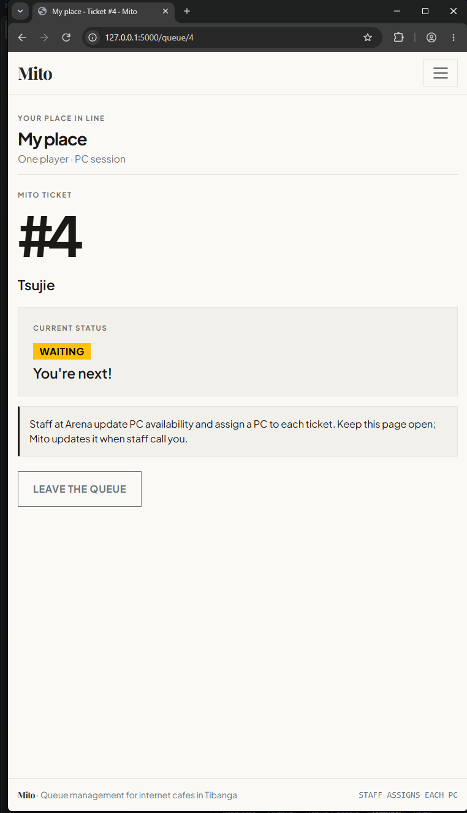
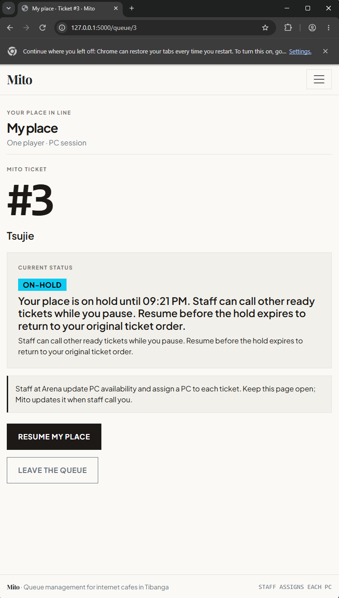

# Week 3 usability test

## Session

- **Date:** October 25, 2026
- **Device:** Laptop
- **Tester:** Anonymous; not a CCC181 classmate; no name or face recorded
- **Persona match:** The tester resembled Tsujie. The same tester also tried the staff task, acting as Ethan when I asked them to.
- **Build:** The app running locally on my laptop; exact commit not recorded. The test happened before the workflow clarification below was added.
- **Timing:** I recorded these times for the same laptop test. They are single-run observations, not averages.

## Tasks and observations

| Task | Result | Time | Observation |
| --- | --- | --- | --- |
| Join the queue for one PC session | Completed after clarification | 7.64 seconds | The time depends on nickname length, whether the tester enters the optional phone number from memory, and whether they are in a rush. The tester asked whether a PC would be assigned automatically after joining. I clarified that staff at Arena update PC availability and assign an open PC before calling the ticket. |
| Find the ticket number and people ahead | Completed | 2.62 seconds | The ticket number and people ahead were front and center; Tsujie noticed and identified them directly. |
| Call the next ticket and mark it served | Completed | 5.7 seconds | The tester took about two deliberate clicks and double-checked the ticket before acting. |

## Design rule check

- Tsujie's rule to make her ticket position easy to find held up: the tester identified the ticket number and people ahead in 2.62 seconds.
- Ethan's rule to show station availability and provide a clear call action held up: the tester completed the call-and-serve task in 5.7 seconds with two deliberate clicks. The question about automatic PC assignment exposed a gap in the customer-side explanation of staff's role.

## Improvement

- **Problem:** Tsujie may join while she is still at school, but does not want to rush when staff call her while she is not yet at Arena. Leaving the queue would make her lose her place.
- **Fix:** Added a 10-minute hold and resume action. While a ticket is on hold, staff can call other ready tickets; resuming before expiry restores the ticket's original order. A hold does not reserve a PC.
- **Before:** The waiting ticket has no way to pause and keep its place.

  

- **After:** My place offers a 10-minute hold and shows the expiry time and resume action.

  

### PC-assignment clarification

The tester also asked whether a PC would be assigned automatically after joining. I clarified that staff at Arena update which PCs are free, assign one to the oldest waiting ticket, and call that customer. I then made that workflow explicit on Join, My place, and Staff. The tester did not retest this wording change, so I have not recorded it as a verified usability improvement.
