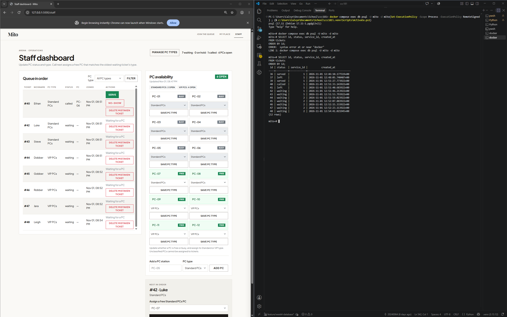
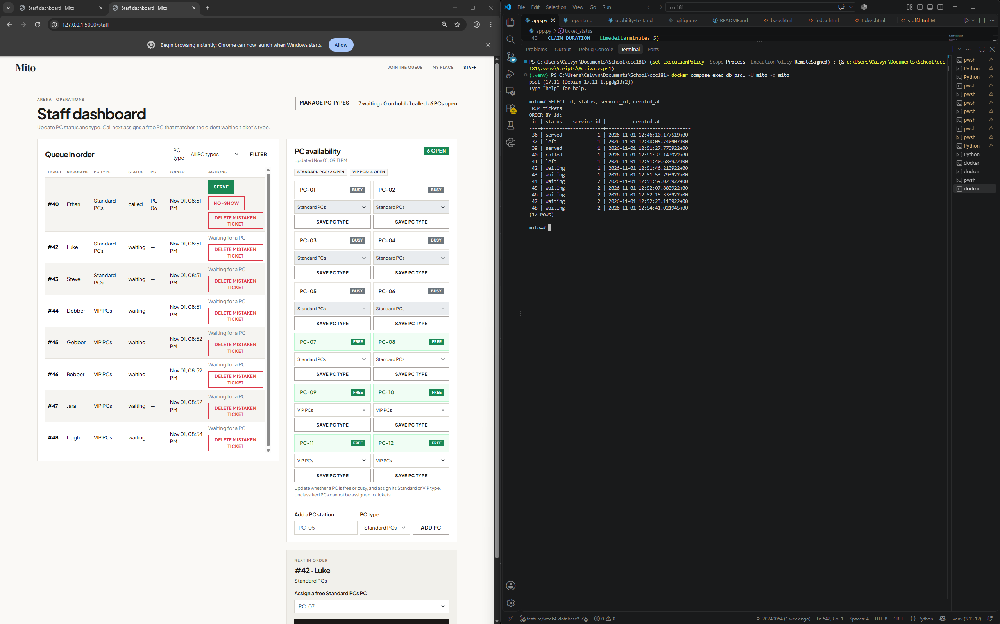

# Week 4 persistence check

## Restart test

I checked persistence in PostgreSQL 17 (`mito-db`) with this query in both screenshots:

```sql
SELECT id, status, service_id, created_at
FROM tickets
ORDER BY id;
```

I kept the two earlier CRUD tickets (#36 and #37) and the nine requested sample tickets (#39–#47). Ticket #38 had been hard-deleted during the CRUD check. Ticket #48, Leigh, was also present, so the query shows 12 rows. The states in the final screenshot pair are Tsujie (#39) served, Ethan (#40) called, Lex (#41) left, and tickets #42–#48 waiting:

```text
 id | status  | service_id |          created_at
----+---------+------------+-------------------------------
 36 | served  |          1 | 2026-11-01 12:46:10.177519+00
 37 | left    |          1 | 2026-11-01 12:48:05.740407+00
 39 | served  |          1 | 2026-11-01 12:51:27.773922+00
 40 | called  |          1 | 2026-11-01 12:51:33.143922+00
 41 | left    |          1 | 2026-11-01 12:51:40.683922+00
 42 | waiting |          1 | 2026-11-01 12:51:46.213922+00
 43 | waiting |          1 | 2026-11-01 12:51:53.793922+00
 44 | waiting |          2 | 2026-11-01 12:51:59.023922+00
 45 | waiting |          2 | 2026-11-01 12:52:07.883922+00
 46 | waiting |          2 | 2026-11-01 12:52:15.333922+00
 47 | waiting |          2 | 2026-11-01 12:52:23.113922+00
 48 | waiting |          2 | 2026-11-01 12:54:41.021945+00
(12 rows)
```

The nine requested sample tickets were created at varied intervals of about 3–10 seconds; the older CRUD tickets and Leigh remained in the database. I stopped Flask, ran `docker compose down` without `-v`, confirmed no services were running, then ran `docker compose up -d` and waited for PostgreSQL to become healthy before restarting Flask.

Ethan's five-minute claim deadline elapsed while I was checking the restarted app. Mito changed #40 to `no-show` and freed PC-06, as designed. I then restored #40 to `called` and PC-06 to `busy` before taking the final after screenshot. Its original `created_at` stayed the same, but its call deadline was refreshed. The final screenshots show the same 12 ticket IDs, statuses, service IDs and creation times in the requested query. I count NFR-01 as passed because the ticket records and their stored creation times remained in PostgreSQL across the restart; the call-expiry transition and later re-call are recorded here so the screenshot pair is not mistaken for an untouched comparison of every ticket field.





## Rebuild from scratch

I ran `docker compose down -v`, then `docker compose up -d`, `flask --app app db upgrade`, and `flask --app app seed`. The old database volume was removed. All three migrations applied, and the seed recreated 12 stations: eight Standard PCs and four VIP PCs. The new database had zero tickets. I confirmed that Join displayed both PC types, created a temporary Standard ticket, and opened its My place page. I then deleted that temporary ticket. `flask db check` reported no pending schema changes.

The rebuilt PostgreSQL database and Flask app both worked. The app was available at `http://127.0.0.1:5000` while Flask was running.

I also tested the migrations on a separate temporary database: all three upgraded successfully, downgraded to `base`, then upgraded again. `flask --app app db check` reported no pending schema changes. I dropped the temporary database afterward, leaving the queue database untouched.
