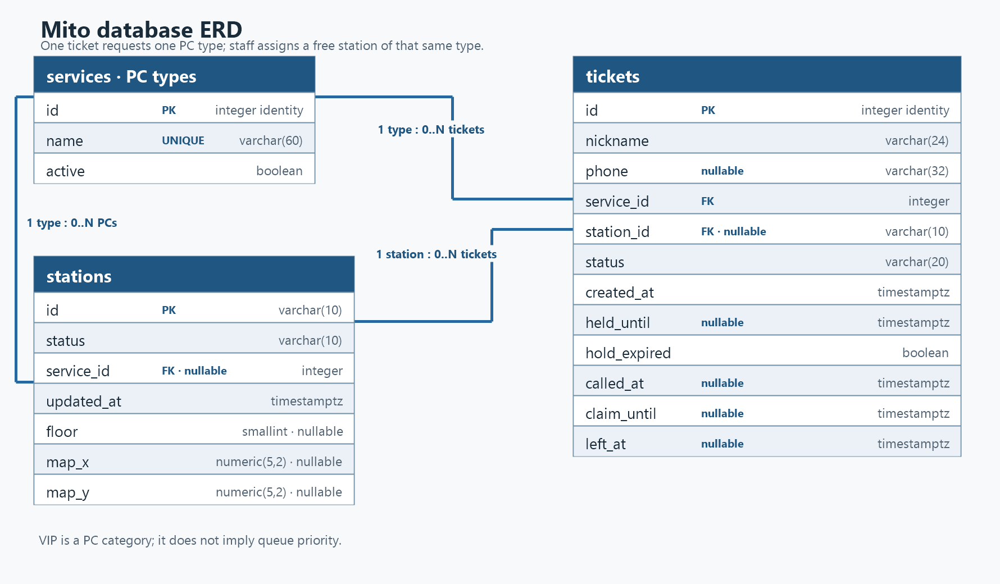
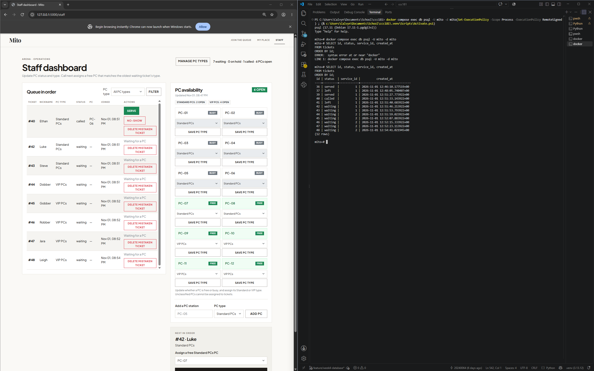
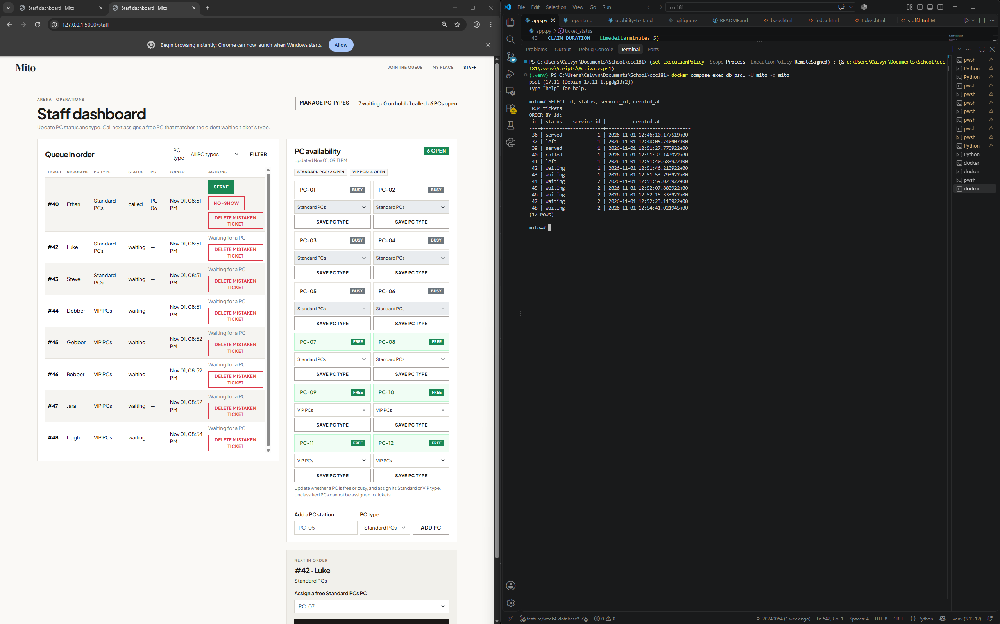

# Week 4 report: Mito and PostgreSQL

## Title details

- **App:** Mito
- **Setting:** Internet cafés such as Arena
- **Student:** Calvyn Kent L. Adeva
- **Student ID:** 2024-0064
- **Section:** CS3B
- **Date:** November 1, 2026
- **Pull request:** [Week 4: PostgreSQL persistence for Mito (#5)](https://github.com/calvynddb/ccc181/pull/5)

## Requirements

I wrote 16 functional requirements and 6 non-functional requirements. My MVP is FR-01–FR-09 and NFR-01–NFR-03, NFR-05 and NFR-06. The requirements and the Part 1 review are in [docs/requirements.md](../requirements.md). That review helped me decide what the database should support now: per-type PC availability, ticket status and queue position, customer holds, and staff assignment. I kept the PC map as later work and dropped a numeric wait estimate because customers can extend PC sessions indefinitely, so the café cannot predict when a station will become free.

## ERD



One PC type can have zero or many tickets and stations. Each ticket belongs to one PC type; each station has one type after staff classifies it. A station can be associated with zero or many tickets over time; a ticket has zero or one assigned station because staff assigns the PC after a customer joins. The seed configures PC-01–PC-08 as Standard and PC-09–PC-12 as VIP. The full typed schema and normalization notes are in [schema.md](schema.md).

## Schema

I captured the following `\d` output from PostgreSQL after applying the current migrations:

```text
                               Table "public.services"
 Column |         Type          | Collation | Nullable |           Default
--------+-----------------------+-----------+----------+------------------------------
 id     | integer               |           | not null | generated always as identity
 name   | character varying(60) |           | not null |
 active | boolean               |           | not null | true
Indexes:
    "services_pkey" PRIMARY KEY, btree (id)
    "services_name_key" UNIQUE CONSTRAINT, btree (name)
Check constraints:
    "ck_services_name_not_blank" CHECK (btrim(name::text) <> ''::text)
Referenced by:
    TABLE "tickets" CONSTRAINT "tickets_service_id_fkey" FOREIGN KEY (service_id) REFERENCES services(id) ON DELETE RESTRICT

                                 Table "public.stations"
   Column   |           Type           | Collation | Nullable |          Default
------------+--------------------------+-----------+----------+---------------------------
 id         | character varying(10)    |           | not null |
 status     | character varying(10)    |           | not null | 'free'::character varying
 service_id | integer                  |           |          |
 updated_at | timestamp with time zone |           | not null | now()
 floor      | smallint                 |           |          |
 map_x      | numeric(5,2)             |           |          |
 map_y      | numeric(5,2)             |           |          |
Indexes:
    "stations_pkey" PRIMARY KEY, btree (id)
Foreign-key constraints:
    "fk_stations_service_id_services" FOREIGN KEY (service_id) REFERENCES services(id) ON DELETE RESTRICT
Check constraints:
    "ck_stations_floor" CHECK (floor IS NULL OR (floor = ANY (ARRAY[1, 2])))
    "ck_stations_id_format" CHECK (id::text ~ '^PC-[0-9]{2}$'::text)
    "ck_stations_map_location_complete" CHECK (map_x IS NULL AND map_y IS NULL OR map_x IS NOT NULL AND map_y IS NOT NULL AND floor IS NOT NULL)
    "ck_stations_map_x" CHECK (map_x IS NULL OR map_x >= 0::numeric AND map_x <= 100::numeric)
    "ck_stations_map_y" CHECK (map_y IS NULL OR map_y >= 0::numeric AND map_y <= 100::numeric)
    "ck_stations_status" CHECK (status::text = ANY (ARRAY['free'::character varying, 'busy'::character varying]::text[]))
Referenced by:
    TABLE "tickets" CONSTRAINT "tickets_station_id_fkey" FOREIGN KEY (station_id) REFERENCES stations(id) ON DELETE RESTRICT

                                    Table "public.tickets"
    Column    |           Type           | Collation | Nullable |           Default
--------------+--------------------------+-----------+----------+------------------------------
 id           | integer                  |           | not null | generated always as identity
 nickname     | character varying(24)    |           | not null |
 phone        | character varying(32)    |           |          |
 service_id   | integer                  |           | not null |
 station_id   | character varying(10)    |           |          |
 status       | character varying(20)    |           | not null | 'waiting'::character varying
 created_at   | timestamp with time zone |           | not null | now()
 held_until   | timestamp with time zone |           |          |
 hold_expired | boolean                  |           | not null | false
 called_at    | timestamp with time zone |           |          |
 claim_until  | timestamp with time zone |           |          |
 left_at      | timestamp with time zone |           |          |
Indexes:
    "tickets_pkey" PRIMARY KEY, btree (id)
Check constraints:
    "ck_tickets_called_fields_required" CHECK (status::text <> 'called'::text OR station_id IS NOT NULL AND called_at IS NOT NULL AND claim_until IS NOT NULL)
    "ck_tickets_claim_deadline_valid" CHECK (claim_until IS NULL OR called_at IS NOT NULL AND claim_until > called_at)
    "ck_tickets_expired_hold_is_no_show" CHECK (NOT hold_expired OR status::text = 'no-show'::text)
    "ck_tickets_hold_after_creation" CHECK (held_until IS NULL OR held_until > created_at)
    "ck_tickets_hold_status_consistent" CHECK (status::text = 'on-hold'::text AND held_until IS NOT NULL OR status::text <> 'on-hold'::text AND held_until IS NULL)
    "ck_tickets_left_time" CHECK (status::text <> 'left'::text OR left_at IS NOT NULL)
    "ck_tickets_nickname_not_blank" CHECK (btrim(nickname::text) <> ''::text)
    "ck_tickets_no_show_has_reason" CHECK (status::text <> 'no-show'::text OR hold_expired OR called_at IS NOT NULL)
    "ck_tickets_phone_valid" CHECK (phone IS NULL OR phone::text ~ '^[0-9+() .-]+$'::text AND length(regexp_replace(phone::text, '[^0-9]'::text, ''::text, 'g'::text)) >= 7 AND length(regexp_replace(phone::text, '[^0-9]'::text, ''::text, 'g'::text)) <= 15)
    "ck_tickets_served_fields_required" CHECK (status::text <> 'served'::text OR station_id IS NOT NULL AND called_at IS NOT NULL)
    "ck_tickets_status" CHECK (status::text = ANY (ARRAY['waiting'::character varying, 'on-hold'::character varying, 'called'::character varying, 'served'::character varying, 'no-show'::character varying, 'left'::character varying]::text[]))
Foreign-key constraints:
    "tickets_service_id_fkey" FOREIGN KEY (service_id) REFERENCES services(id) ON DELETE RESTRICT
    "tickets_station_id_fkey" FOREIGN KEY (station_id) REFERENCES stations(id) ON DELETE RESTRICT
```

The tables have named checks for allowed statuses, valid phone formats, PC IDs and map coordinates. Ticket foreign keys use `ON DELETE RESTRICT` for services and stations.

## Design decisions

1. **Standard and VIP are stored as PC types.** I used the existing `services` table for PC types and linked each station to one type. When I added VIP PCs, I needed a migration and seed update as well as matching choices on Join and Staff. This keeps type-specific availability and assignment tied to FR-01, FR-03, FR-04, FR-08 and FR-16.
2. **Availability comes from station records.** Each PC has a stored free/busy state, and staff assigns a free station of the ticket's selected type to the oldest waiting customer in that queue. Mito calculates open counts from those stations instead of keeping a second count that could drift from the inventory.
3. **Ticket lifecycle times are stored; queue position is calculated.** `created_at`, `held_until`, `called_at`, `claim_until` and `left_at` preserve when the ticket changed state. The queue order and number ahead are calculated from tickets, so the database does not need a position value that would have to be rewritten whenever the queue changes.

## Self-review

The review covered ten data scenarios in [schema-review.md](schema-review.md). It caught that a foreign key alone cannot guarantee a station is free or the right type, so the call action filters and locks the matching ticket and station before updating them together. I also kept queue position and daily departure totals derived rather than stored, retained separate fields for hold and call deadlines, and made the map coordinates optional because the map is not part of this week's build.

## Migrations

- `c192066da265_initial_tables.py` creates the services, stations and tickets tables, including their keys and constraints.
- `c3e6661fc4af_rename_services_active_field.py` renames the existing service activity column to `active` without discarding its values.
- `f837738006a7_add_pc_type_to_stations.py` adds the station-to-PC-type link and renames the existing queue types to Standard PCs and VIP PCs.

I tested all three migrations on a separate temporary database: upgrade to head, downgrade to `base`, and upgrade to head again all succeeded. `flask --app app db check` reported no pending schema changes; the temporary database was dropped afterward.

## CRUD

I captured the resulting state for each CRUD action. For Create, I used the capture that shows the new ticket on My place and in PostgreSQL. The other before-and-after captures were not needed to show the completed action, so I kept the resulting-state screenshots here.

| Action | Route | Requirement | Evidence |
| --- | --- | --- | --- |
| Create a ticket | `POST /join` | FR-01 | [New ticket #36 and saved database row](screenshots/create.png) |
| Read a ticket and queue position | `GET /queue/<ticket_id>` | FR-02 | [Ticket number, status, and people ahead](screenshots/read.png) |
| Update ticket state | `POST /staff/tickets/<ticket_id>/serve` | FR-04 | [Ticket #36 marked served](screenshots/update.png) |
| Leave a ticket (soft delete) | `POST /queue/<ticket_id>/leave` | FR-07 | [Ticket #37 marked as left and retained in PostgreSQL](screenshots/soft-delete.png) |
| Remove a mistaken ticket (hard delete) | `POST /staff/tickets/<ticket_id>/delete` | FR-09 | [Ticket #38 deleted from the queue and PostgreSQL](screenshots/hard-delete.png) |

## Validation

The browser requires a nickname and PC type, limits nickname to 24 characters, and leaves phone optional with a 32-character limit. Three direct Join requests that bypassed the form received HTTP 400 and did not add tickets. PostgreSQL rejected invalid inserts and updates for foreign key, unique, check, not-null, and restrict constraints. The `ON DELETE RESTRICT` message was the most useful because it showed why a PC type with ticket history cannot be deleted. I recorded the commands and PostgreSQL errors in [validation.md](validation.md); the assignment's SQL injection check found no SQL statements built in f-strings.

## Persistence

The before-and-after screenshots and clean rebuild are recorded in [persistence.md](persistence.md). The screenshots show matching ticket IDs, statuses, PC types and original creation times, and the database retained the ticket records across the Docker restart. Ethan's five-minute call deadline expired during the check, so Mito correctly moved his ticket to no-show and released PC-06; I restored the called state before taking the final after screenshot. I count NFR-01 as passed for persistence, and recorded that expiry and re-call so the screenshots are not presented as an untouched comparison of every ticket field. The clean rebuild from migrations also succeeded.





## Reflection

The hardest Week 4 change was adding VIP PCs after the database work had started. It affected more than the Join form label: each station needed a type in PostgreSQL, seed data had to classify the 8 Standard and 4 VIP stations, and staff filtering and Call next had to match a ticket to a free PC of the same type. I had to trace that change through the model, migration, seed command and routes, then check that the dashboard showed type-specific availability and did not offer a mismatched PC. I also corrected the availability timestamps shown in Join and Staff to use Manila time while keeping timezone-aware timestamps in PostgreSQL. NFR-01 was the hardest requirement to validate because ticket status is stored while queue position and PC counts are calculated; the restart evidence had to show both the saved rows and the resulting app state. A report Ethan could use is the number of customers who leave before being served, grouped by PC type and local day. FR-13 preserves the data for that later query.

## Declaration

ChatGPT Codex helped me troubleshoot Flask, SQLAlchemy and PostgreSQL implementation errors. I read through the suggested changes and retraced how each request moved through the route, model and database instead of applying fixes without understanding them. I ran the migrations, checked the resulting schema, used Join, My place and Staff, and compared the saved ticket and station states with the Week 4 requirements. When something did not behave as expected, I checked the query and stored values, corrected the cause, and repeated the flow before keeping the change.
