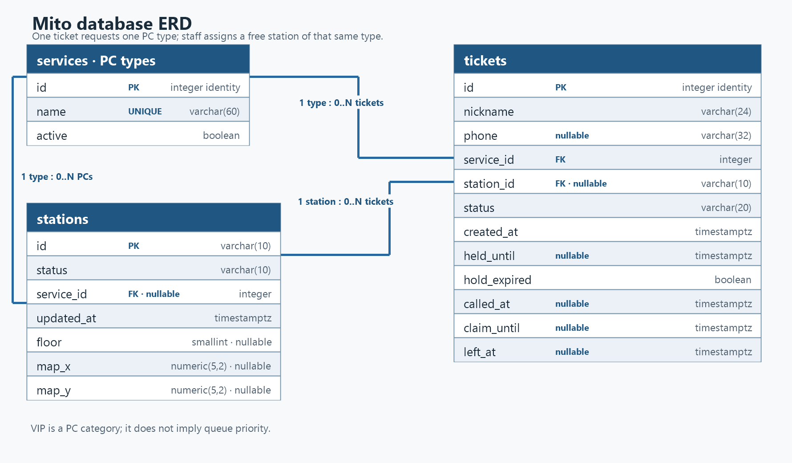

# Mito database schema

This draft maps the Week 4 requirements to a PostgreSQL schema for Mito. It stores tickets, PC types, and stations. `services` is the existing table name for the Standard PC and VIP PC types; each station and ticket refers to its type. The seed creates PC-01 through PC-08 as Standard PCs and PC-09 through PC-12 as VIP PCs. It does not store the queue itself, the number of people ahead, or open-PC counts because those are calculated from stored rows. FR-14 (a numeric wait estimate) is dropped because PC sessions can be extended indefinitely.

## 2a. Requirement nouns

The queue is the set of active tickets ordered by `created_at`, with ticket ID as a tie-breaker. A separate queue table is not needed. Customer nickname and optional phone are kept on the ticket because Mito has no customer accounts or persistent customer identity.

| Req ID | Requirement with nouns bolded | Nouns | Table or column? |
| --- | --- | --- | --- |
| FR-01 | A **customer** can join the **queue** for one **PC** using a **nickname**, optional **phone number**, and selected **PC type**. | customer, queue, PC, nickname, phone number, PC type | `tickets.nickname`, `tickets.phone`, `tickets.service_id`; queue is computed |
| FR-02 | A customer can see their **ticket number**, **status**, and **waiting tickets ahead**. | ticket number, status, tickets ahead | `tickets.id`, `tickets.status`; tickets ahead is computed |
| FR-03 | A customer can see how many **Standard and VIP PCs are open** and when **availability** was last updated. | PCs, type, open count, availability update | `stations.status`, `stations.updated_at`, `stations.service_id`; counts are computed by type |
| FR-04 | Staff can view **tickets in order**, assign a free **matching PC type**, call the customer, and mark the ticket **served** or **no-show**. | tickets, order, PC type, staff actions, status | `tickets` and `stations`; the queue is grouped by type and ordered by join time; calls match `tickets.service_id` with `stations.service_id` |
| FR-05 | Staff can mark each **PC** **free** or **busy**. | PC, station status | `stations.id`, `stations.status` |
| FR-06 | A customer can place a **ticket** on a 10-minute **hold**, see if the hold **expired**, and resume in its original order. | ticket, hold, expiry, duration, order | `tickets.status`, `tickets.held_until`, `tickets.hold_expired`; order is computed from ticket ID |
| FR-07 | A customer can leave the **queue** and keep the **departure status** on their ticket. | queue, departure status | `tickets.status`, `tickets.left_at`; active queue is computed |
| FR-08 | Staff can add and rename a **PC type** and deactivate it. | PC type, name, active state | `services.name`, `services.active` |
| FR-09 | Staff can permanently delete a mistaken **ticket**. | ticket, deletion | The ticket row is deleted; no extra column is needed |
| FR-10 | My place can show the assigned **PC** on a **floor map** with its floor and position. | PC, floor, map position | `stations.floor`, `stations.map_x`, `stations.map_y` (Later) |
| FR-13 | Staff can count customers who **leave**, by **PC type** and **day**. | departures, PC type, day | `tickets.status`, `tickets.left_at`, `tickets.service_id`; the count is computed |
| FR-15 | After staff assigns a **PC** and calls a **customer**, My place shows the exact five-minute **response deadline** and explains the **no-show** outcome. | PC, customer, response deadline, no-show | `tickets.status`, `tickets.called_at`, `tickets.claim_until`, `tickets.station_id` |
| FR-16 | Staff can add a **PC station** with a unique **PC ID** and **PC type**, and Mito includes it in the matching **availability count** and **dashboard**. | PC station, PC ID, PC type, availability count, dashboard | `stations.id`, `stations.service_id`, `stations.status`; availability is computed |

FR-11 and FR-12 change how often the screens refresh, but require no additional stored facts. FR-14 is Dropped and has no database fields.

## 2b. Tables and columns

| Table | Columns | Why this table exists |
| --- | --- | --- |
| `services` | `id`, `name`, `active` | Stores PC types such as Standard PCs and VIP PCs. Deactivation preserves linked stations and old tickets. |
| `stations` | `id`, `status`, `service_id`, `updated_at`, `floor`, `map_x`, `map_y` | Stores each PC's ID, type, and availability; future map details are nullable and support FR-10. |
| `tickets` | `id`, `nickname`, `phone`, `service_id`, `station_id`, `status`, `created_at`, `held_until`, `hold_expired`, `called_at`, `claim_until`, `left_at` | Stores one customer's queue visit, its service, optional assigned station and lifecycle times. |

There is no `users` table because customers do not create accounts. A nickname can be reused, and a phone number is optional, so neither is a reliable customer key. There is no `queue` table because queue order is calculated from tickets. The open-PC count by type and number ahead are also calculated, not stored. No wait-time estimate is stored because session duration is unpredictable and FR-14 is dropped.

## 2c. Types, constraints and reasons

| Table | Column | PostgreSQL type | Constraint | Why |
| --- | --- | --- | --- | --- |
| `services` | `id` | `integer` | `GENERATED ALWAYS AS IDENTITY PRIMARY KEY` | Database-generated stable service key. |
| `services` | `name` | `varchar(60)` | `NOT NULL UNIQUE CHECK (btrim(name) <> '')` | Each service needs a non-empty, unambiguous name. Renaming does not change ticket references. |
| `services` | `active` | `boolean` | `NOT NULL DEFAULT true` | Staff can switch a service off without deleting its ticket history. |
| `stations` | `id` | `varchar(10)` | `PRIMARY KEY CHECK (id ~ '^PC-[0-9]{2}$')` | Keeps the café's station IDs such as `PC-01` stable and correctly formatted. |
| `stations` | `status` | `varchar(10)` | `NOT NULL CHECK (status IN ('free', 'busy'))` | A station can only be in one of the two states staff manage. |
| `stations` | `service_id` | `integer` | `NULL REFERENCES services(id) ON DELETE RESTRICT` | Identifies whether this is a Standard or VIP PC. Nullable only while staff has not classified a station; an unclassified PC cannot be assigned to a ticket. |
| `stations` | `updated_at` | `timestamptz` | `NOT NULL DEFAULT now()` | Records when station availability was last changed; update it whenever staff changes the station state. |
| `stations` | `floor` | `smallint` | `NULL CHECK (floor IN (1, 2))` | Supports the optional first- or second-floor map in FR-10. It can stay empty until map details are added. |
| `stations` | `map_x` | `numeric(5,2)` | `NULL CHECK (map_x BETWEEN 0 AND 100)` | Stores the station's horizontal percentage position on a future floor map. |
| `stations` | `map_y` | `numeric(5,2)` | `NULL CHECK (map_y BETWEEN 0 AND 100)` | Stores the station's vertical percentage position on a future floor map. |
| `tickets` | `id` | `integer` | `GENERATED ALWAYS AS IDENTITY PRIMARY KEY` | This is also the visible ticket number; its primary key prevents duplicates. |
| `tickets` | `nickname` | `varchar(24)` | `NOT NULL CHECK (btrim(nickname) <> '')` | A ticket must identify the customer in the staff queue; blank nicknames are invalid. |
| `tickets` | `phone` | `varchar(32)` | `NULL CHECK (phone IS NULL OR (phone ~ '^[0-9+() .-]+$' AND length(regexp_replace(phone, '[^0-9]', '', 'g')) BETWEEN 7 AND 15))` | Phone is optional, but a supplied number may include formatting around its 7–15 digits. The app and browser must also accept at most 32 characters. |
| `tickets` | `service_id` | `integer` | `NOT NULL REFERENCES services(id) ON DELETE RESTRICT` | Every ticket belongs to an existing service; deleting that service must not erase its history. |
| `tickets` | `station_id` | `varchar(10)` | `NULL REFERENCES stations(id) ON DELETE RESTRICT` | A ticket has no station before staff assignment, then refers to the assigned PC. Retain the station reference for history. |
| `tickets` | `status` | `varchar(20)` | `NOT NULL DEFAULT 'waiting' CHECK (status IN ('waiting', 'on-hold', 'called', 'served', 'no-show', 'left'))` | Limits stored ticket states to those used by Mito. `left` is distinct from staff-recorded `no-show`. |
| `tickets` | `created_at` | `timestamptz` | `NOT NULL DEFAULT now()` | Records when the ticket joined; supports stable ordering and daily grouping. |
| `tickets` | `held_until` | `timestamptz` | `NULL CHECK (held_until IS NULL OR held_until > created_at)` | Records the hold expiry without storing a separate queue position. |
| `tickets` | `hold_expired` | `boolean` | `NOT NULL DEFAULT false` | Persists whether a no-show resulted from an expired customer hold, so the status remains distinguishable after restart. |
| `tickets` | `called_at` | `timestamptz` | `NULL` | Records when staff called the ticket; empty before a call. |
| `tickets` | `claim_until` | `timestamptz` | `NULL CHECK (claim_until IS NULL OR (called_at IS NOT NULL AND claim_until > called_at))` | Stores the exact five-minute response deadline when staff calls the customer, so My place can show it consistently after refresh or restart. Retain it on no-show tickets for history. |
| `tickets` | `left_at` | `timestamptz` | `NULL` | Records when a customer leaves so FR-13 can count departures by day. |

Additional table checks:

- On `stations`, `map_x` and `map_y` must either both be `NULL` or both be set. If set, `floor` must also be 1 or 2. This prevents a partially specified map location.
- On `tickets`, `status = 'on-hold'` requires `held_until IS NOT NULL`; statuses other than `on-hold` require `held_until IS NULL`. `status = 'left'` requires `left_at IS NOT NULL`; `hold_expired = true` requires `status = 'no-show'`; and `claim_until` requires a non-null `called_at` and must be later than it. A staff-called ticket requires `station_id`, `called_at`, and `claim_until`; retain `claim_until` on its resulting served/no-show ticket. The app sets `claim_until = called_at + 5 minutes` when the call is made. If the customer does not arrive by then, staff marks the ticket no-show and the assigned station returns to free. A hold-expiry no-show has `hold_expired = true` and no call deadline; a missed-call no-show retains `hold_expired = false` and its call deadline.

The required constraint types are present: primary keys on each table; foreign keys from tickets to services and stations and from stations to services; `NOT NULL` on required fields; `UNIQUE` on type names; `CHECK` constraints on names, IDs, statuses, phone and map values; and `timestamptz` for every stored moment in time.

## 2d. ERD

The diagram labels the relationships `1:N`. **One PC type can have zero or many tickets and zero or many stations. Every ticket belongs to exactly one PC type; a station has zero or one type while it is unclassified, then exactly one type. One station can be associated with zero or many tickets over time; each ticket has zero or one assigned station** because `tickets.station_id` is nullable until staff assigns a PC.

### Foreign-key delete rules

| Foreign key | Delete rule | Reason |
| --- | --- | --- |
| `tickets.service_id → services.id` | `ON DELETE RESTRICT` | Services should be deactivated, not deleted, while tickets refer to them; this protects queue history and reports. |
| `stations.service_id → services.id` | `ON DELETE RESTRICT` | A PC type with stations cannot be deleted; reassign them or deactivate the type. |
| `tickets.station_id → stations.id` | `ON DELETE RESTRICT` | A station referenced by ticket history cannot be deleted and leave that history ambiguous. |

Tickets have no child table. FR-09 permits staff to permanently delete a mistakenly created ticket itself; it does not cascade to other records.

### Requirement and NFR traceability

| Item | Database effect |
| --- | --- |
| FR-01, FR-02, FR-04, FR-06, FR-07, FR-09, FR-13, FR-15 | Stored or updated in `tickets`; ticket position and departure totals are calculated from ticket rows. FR-06 expiry reason is retained in `hold_expired`; FR-15 deadline is stored in `claim_until`. |
| FR-03, FR-04, FR-05, FR-16 | Stored in `stations`; open-PC counts are calculated from free station rows grouped by `service_id`. Matching ticket and station types are required for a call. |
| FR-01, FR-08 | Stored in `services`; inactive types remain available to historical tickets and assigned stations. |
| FR-10 (Later) | Optional `floor`, `map_x`, and `map_y` on `stations`. |
| FR-11, FR-12 | No additional columns; the screens refresh existing data. |
| FR-14 (Dropped) | No field or table; the café cannot provide a reliable end time for an occupied PC. |
| NFR-01 | All three tables persist in PostgreSQL; verified later by the restart exercise. |
| NFR-02 | The database-generated `tickets.id` primary key is unique. |
| NFR-03 | Password and secret-key handling belongs in `.env` and Git configuration, not in these tables. |
| NFR-04, NFR-05 | Responsive layout and keyboard interaction are interface concerns, not ERD entities. |
| NFR-06 | Flask validation and database `NOT NULL`, `UNIQUE`, `CHECK`, and foreign-key constraints reject invalid input. |

## 2e. Normalization

1. **1NF — one value per cell:** Yes. Each ticket refers to one service and at most one station. No column stores a list of services, PCs, or customers.
2. **2NF — depends on the whole key:** Yes. There is no many-to-many join table; each non-key column belongs to the single primary key of its row.
3. **3NF — no hidden copies:** Yes. PC type names and active state are stored once in `services`; each station and ticket refers to that type by foreign key. Station status and location are stored once in `stations`. Nickname and optional phone are facts about one queue visit, not a reusable customer account. Ticket position and open-PC counts are computed rather than copied into rows.
